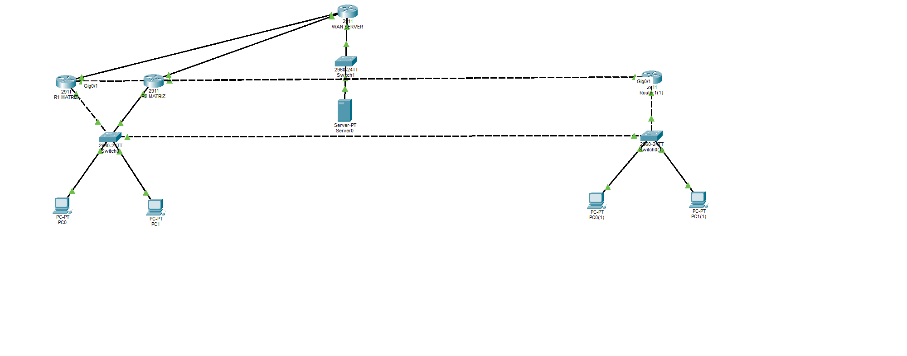

# 🌐 Enterprise Network Redundancy & Edge Topology Lab (Cisco Packet Tracer)



## 📌 Visão Geral do Projeto
Este repositório contém o projeto de simulação de infraestrutura de rede corporativa para alta disponibilidade, roteamento dinâmico entre sites e resiliência de borda com failover automático.

A arquitetura simula a interconexão entre uma **Matriz** e uma **Filial**, com redundância de gateway na LAN via **HSRP**, suporte a múltiplos enlaces WAN para o Provedor de Internet (**Dual WAN NAT Overload/PAT**), roteamento interno via **OSPF (Área 0)** e publicação externa de serviços corporativos (Port Forwarding).

---

## 🏗️ Arquitetura e Especificações Técnicas

### 1. Matriz (LAN & Alta Disponibilidade - VLAN 10)
* **Rede LAN:** `192.168.0.0/24`
* **Gateway Virtual (HSRP Grupo 10):** `192.168.0.1`
* **R1MATRIZ (Ativo):**
  * Subinterface `Gi0/0.10`: IP Real `192.168.0.2/24`
  * HSRP Priority: `110` (Preemption Ativado)
  * Interface WAN: `Gi0/2` (`ip nat outside`)
* **r2matriz (Standby/Backup):**
  * Subinterface `Gi0/0.10`: IP Real `192.168.0.3/24`
  * HSRP Priority: `100` (Default)
  * Interface WAN: `Gi0/2` (`ip nat outside`)
* **Servidor Web Interno:** IP `192.168.0.100/24` (Porta TCP 80 mapeada para a borda).

### 2. Filial (Site Remoto - VLAN 50)
* **Rede LAN:** `192.168.50.0/24`
* **Gateway Local (`Router_Filial`):** IP `192.168.50.1/24`
* **Serviço DHCP:** Distribuição dinâmica de endereços com Gateway `192.168.50.1` e DNS `8.8.8.8`.

### 3. Backbone de Roteamento Dinâmico (OSPF Área 0)
* Roteamento ativo entre `R1MATRIZ`, `r2matriz` e `Router_Filial`.
* Propagação automática de Rota Padrão (`default-information originate`) a partir dos roteadores de borda da Matriz.
* Links WAN ponto a ponto (`/30`) redundantes interconectando a Filial aos dois roteadores principais.

### 4. Borda Dupla & Internet (NAT / PAT / Failover)
* **Link Borda R1MATRIZ ↔ ISP:** Sub-rede `/30` conectada ao `WAN SERVER`.
* **Link Borda r2matriz ↔ ISP:** Sub-rede `/30` dedicada conectada ao `WAN SERVER`.
* **NAT Overload (PAT):** Tradução dinâmica dos IPs privados internos (`192.168.0.0/24` e `192.168.50.0/24`) para navegação externa em ambos os roteadores de borda.
* **NAT Estático (Port Forwarding):** Mapeamento do IP público de borda na porta TCP 80 para acesso ao `Servidor_Web` interno da Matriz.

---

## 🧪 Bateria de Testes e Validação (Homologados)

* [x] **Comunicação e DHCP na Filial:** O `PC_Filial` obtém IP via DHCP e pinga com sucesso o `Servidor_Web` interno (`192.168.0.100`).
* [x] **Navegação Externa via PAT:** Clientes da Matriz e da Filial alcançam o endereço público de testes (`8.8.8.8`) no servidor de borda do ISP.
* [x] **Acesso Externo (Port Forwarding):** Requisições HTTP vindas do ISP com destino ao IP público de borda são direcionadas corretamente para o Servidor Web interno.
* [x] **Teste de Estresse HSRP & Failover de Borda:** Durante um ping contínuo (`ping 8.8.8.8 -t`), a desconexão do cabo do `R1MATRIZ` dispara a transição imediata para o `r2matriz`, que assume a LAN e realiza a tradução de NAT sem perda da sessão.

---

## 🚀 Como Executar no Cisco Packet Tracer
1. Faça o clone deste repositório:
   ```bash
   git clone [https://github.com/silentz-z/cisco-enterprise-network-redundancy.git](https://github.com/silentz-z/cisco-enterprise-network-redundancy.git)
